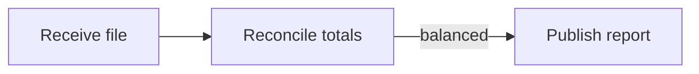

# Mermaid Workflow Edits

When someone renames a step on a diagram, a visual editor needs to update the corresponding text without disturbing the surrounding workflow. This TypeScript library is the source-editing component of an independent Mermaid desktop editor. It maps diagram elements to line and column spans and applies edits back to the source.

## Try a workflow edit

With Node.js 22 or newer, run these commands from the repository root. TypeScript is the only development dependency.

```sh
npm ci
npm run demo
npm test
```

The example renames the middle step in this reporting workflow. The edge into the publication step retains its condition.



## How it works

`parse(source)` returns the elements it recognizes, their source spans, and a line map. The scanners cover common flowchart, sequence, class, state, and entity-relationship syntax. Each scanner supports a subset of its diagram grammar.

`applyPatch(source, patch)` applies operations such as renaming a node or editing an edge label. The tests compare the complete updated source and parse it again to check element identity and edge endpoints. The public edition contains the editing library and synthetic examples. Rendering and desktop integration belong to the larger application.
